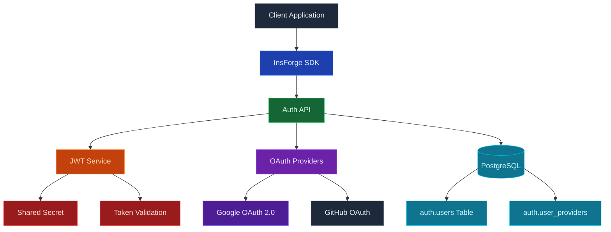

Use InsForge Authentication to handle sign-up, login, sessions, and identity for your app. Users can sign in with email and password, magic link, one-time code, OAuth providers (Google, GitHub, Apple, and others), or any OIDC-compliant identity provider you bring. InsForge issues JSON Web Tokens on login, and every other product on the platform consumes the same token.

<Frame caption="Configured sign-in methods: email and password, Google, and GitHub OAuth.">
  
</Frame>

<Note>
  **Authentication** is checking that a user is who they say they are. **Authorization** is checking what they can do. InsForge handles the first directly and powers the second through [row-level security](/core-concepts/database/overview) policies that read the auth JWT.
</Note>



## Features

### Email and password

The default. New users sign up with an email and password, get a confirmation email, and receive a session JWT on login. Password reset, email verification, and brute-force throttling are built in.

<Note>
  **Self-hosting?** Sending these emails, including passwordless magic-link and one-time-code sign-in, requires an email provider. Cloud-linked projects use the managed sender automatically; a self-hosted instance must set up [Custom SMTP](/core-concepts/messaging/custom-smtp) first, otherwise verification, reset, and sign-in emails will not be delivered.
</Note>

### Magic link and OTP

Send a one-time link or six-digit code to the user's email. Passwordless sign-in, account recovery, and step-up auth all use the same primitive.

### OAuth providers

First-class support for Google, GitHub, Apple, Microsoft, GitLab, Discord, and more. Add custom OAuth 2.0 / OIDC providers (Keycloak, Okta, Auth0, your own IdP) by URL without writing provider-specific code.

#### Configure a provider

Each social provider needs its own OAuth app, created in that provider's developer console, whose **Client ID** and **Client Secret** you then paste into InsForge. Using Google as the example:

1. In the dashboard, open **Authentication → Auth Methods** and click **Google OAuth**.
2. Follow the **Create a Google OAuth App** link to the [Google Cloud Console](https://console.cloud.google.com/apis/credentials) and create an OAuth 2.0 client. Set its authorized redirect URI to the callback URL the dialog shows — it looks like `https://<your-backend-url>/api/auth/oauth/google/callback`.
3. Copy the app's **Client ID** and **Client Secret** from Google into the matching fields, then click **Add Provider**.

The flow is identical for GitHub, Microsoft, Discord, LinkedIn, Facebook, X, and Apple — only the provider's own developer console changes.

<Note>
  On InsForge Cloud projects you can turn on the **Shared Keys** toggle instead of bringing your own credentials. Shared keys are InsForge-managed OAuth apps that let you start quickly in development; the consent screen shows InsForge's name and logo, so never use them in production.
</Note>

Prefer to script it? The dialog calls an admin-only REST API, so you can configure a provider from a terminal or CI with your project [API key](/faq) (`ik_...`):

```bash
# Create the Google provider config
curl -X POST "$INSFORGE_BASE_URL/api/auth/oauth/configs" \
  -H "Authorization: Bearer $API_KEY" \
  -H "Content-Type: application/json" \
  -d '{"provider":"google","clientId":"<client-id>","clientSecret":"<client-secret>"}'
```

Update an existing provider with `PUT /api/auth/oauth/<provider>/config`, or remove one with `DELETE /api/auth/oauth/<provider>/config`.

### OAuth server mode

Run InsForge itself as an OAuth 2.0 / OIDC identity provider for your own downstream apps. See the [OAuth Server guide](/oauth-server) for the full setup.

### Row-level security

The auth JWT flows through every InsForge SDK call automatically. Postgres RLS policies read claims from the token and decide, row by row, what the user can read and write. The same identity and the same policies apply whether the request hits the database, storage, or a realtime channel.

### `auth.users` in your database

User state lives in your project's Postgres database in the `auth` schema. Join `auth.users` to your application tables via foreign keys, react to identity changes with triggers, and back the whole thing up the same way you back up everything else.

When you add a user from the dashboard, the Auto-confirm toggle sets `email_verified` on the new row. Enable it to mark the email as verified at creation, so the user can sign in without confirming it.

## Build with it

<CardGroup cols={2}>
  <Card title="TypeScript SDK" icon="js" href="/sdks/typescript/auth">
    Sign up, log in, and manage sessions from Node, browser, and edge.
  </Card>

  <Card title="Swift SDK" icon="swift" href="/sdks/swift/auth">
    Native Swift auth client for iOS and macOS.
  </Card>

  <Card title="Kotlin SDK" icon="android" href="/sdks/kotlin/auth">
    Coroutines-first auth client for Android and JVM.
  </Card>

  <Card title="REST API" icon="code" href="/sdks/rest/auth">
    Plain HTTP auth endpoints, callable from any language.
  </Card>
</CardGroup>

## Next steps

- Set up the [CLI](/quickstart) to link your project (the recommended path).
- Browse the [TypeScript SDK reference](/sdks/typescript/auth) for sign-in patterns.
